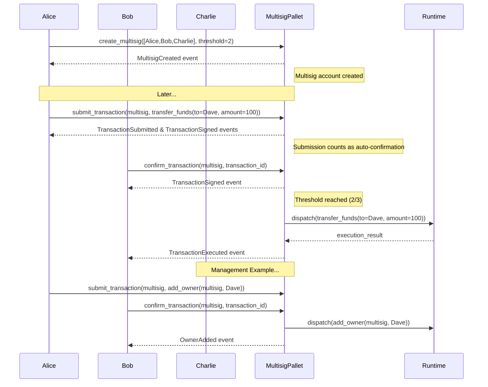
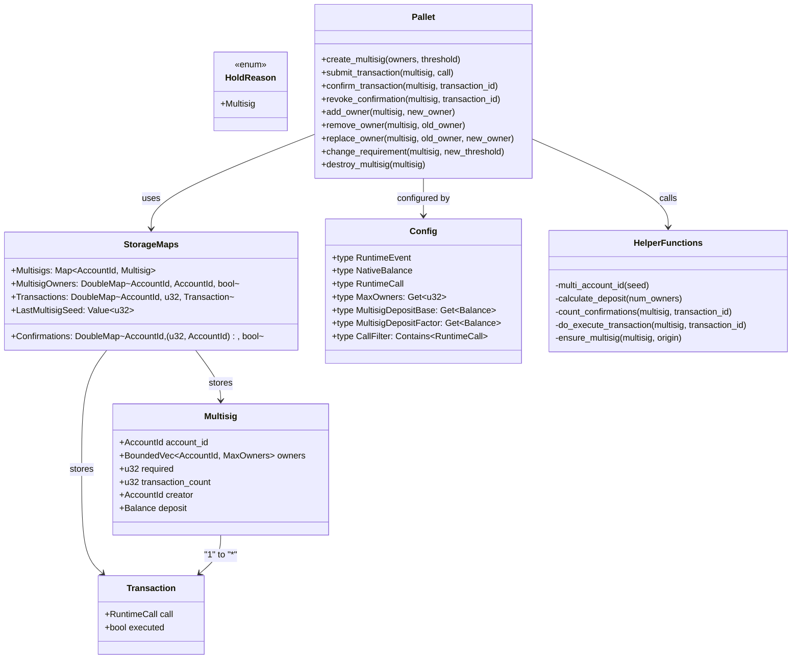
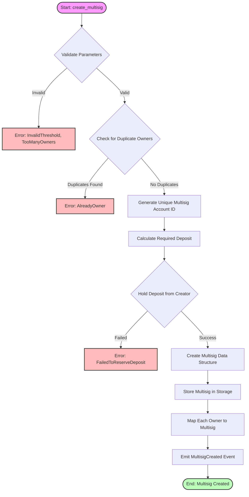
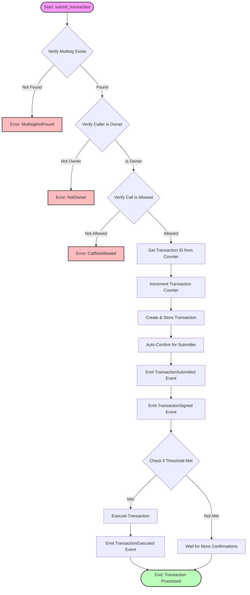
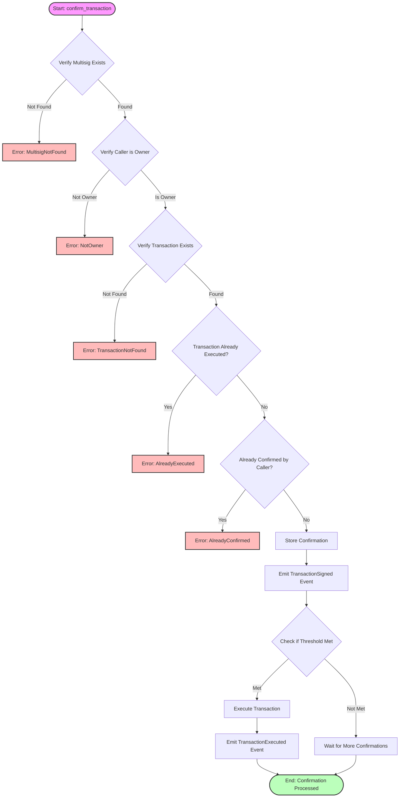

## Project Option

This project implements **Challenge Option 2: Stateful Multisig** from the assignment, with the following required features:

- ✅ Create, manage, and submit multisig transactions
- ✅ Generate unique addresses for multisigs
- ✅ Full transaction lifecycle management
- ✅ Multisig destruction process
- ✅ Configurable call filter support

The implementation aims to provide a robust, production-ready solution that could be integrated into existing Substrate-based blockchains to enhance their multisignature capabilities.

## Stateful Multisig Pallet

> A robust, on-chain stateful multisig solution for Substrate-based blockchains, inspired by the Gnosis Safe architecture.

## Table of Contents

- [Overview](#overview)
- [Sequence Diagrams](#sequence-diagrams)
- [High-Level Design](#high-level-design)
- [Low-Level Design](#low-level-design)
- [Design Decision Analysis and Trade-offs](#design-decision-analysis-and-trade-offs)
- [Testing](#testing)
- [Migration Story](#migration-story)
- [Best Practices](#best-practices)
- [Rust Docs](#rust-docs)
- [How to Run](#how-to-run) 

## Overview

This Stateful Multisig pallet is a comprehensive, modular solution that allows users to create, manage, and execute multi-signature transactions on Substrate-based blockchains. Unlike stateless multisig implementations that require off-chain coordination, this pallet stores the entire transaction lifecycle on-chain, providing better transparency, accountability, and user experience.

The implementation draws inspiration from the Gnosis Safe multisig contract architecture, but adapts the design for the unique capabilities of Substrate's FRAME system.

## Sequence Diagrams



## High-Level Design

### Core Architecture

The stateful multisig pallet implements a complete solution for managing shared accounts that require multiple approvals for transaction execution. 

### Key Components and Interactions

#### 1. Multisig Wallet Entity

- Represents a shared account with multiple owners and a confirmation threshold
- Maintains its own unique on-chain identity (account address)
- Stores configuration including owner list, confirmation threshold, and transaction counter
- Acts as a self-governing entity that can only be modified through its own consensus mechanism

#### 2. Transaction Proposals

- Encapsulate calls that the multisig wallet wants to execute
- Track execution status and associated confirmations
- Serve as the focal point for owner consensus
- Execute automatically when sufficient confirmations are gathered

#### 3. Confirmation Mechanism

- Records owner approvals for specific transactions
- Counts confirmations against required threshold
- Supports both confirmation and revocation operations
- Triggers execution when threshold is met

#### 4. Call Filter

- Restricts which functions can be called via the multisig
- Provides runtime-configurable security boundaries
- Prevents execution of potentially dangerous operations like sudo calls


## Low-Level Design

### Data Model Diagram



### Storage Structure Design

The pallet implements four strategic storage items to efficiently manage multisig state:

#### 1. Multisigs Storage Map

```rust
#[pallet::storage]
pub type Multisigs<T: Config> = StorageMap<_, Twox64Concat, T::AccountId, Multisig<T>>;
```

This primary storage map associates a multisig address with its configuration. I chose a direct key-value mapping to allow quick access to multisig details without reading associated transactions or confirmations.

#### 2. Transactions Double Map

```rust
#[pallet::storage]
pub type Transactions<T: Config> = StorageDoubleMap
    _,
    Twox64Concat,
    T::AccountId, // Multisig account ID
    Twox64Concat,
    u32, // Transaction ID
    Transaction<T>,
>;
```

The double map structure provides efficient lookups by both multisig address and transaction ID. This design choice enables:

- O(1) access to specific transactions
- Ability to iterate transactions for a specific multisig
- Clear separation of transactions between different multisigs

#### 3. Confirmations Double Map

```rust
#[pallet::storage]
pub type Confirmations<T: Config> = StorageDoubleMap
    _,
    Twox64Concat,
    T::AccountId, // Multisig account ID
    Twox64Concat,
    (u32, T::AccountId), // (Transaction ID, Owner)
    bool,
>;
```

This storage item tracks which owners have confirmed which transactions. The composite key `(transaction_id, owner)` enables:

- Fast checking if a specific owner has confirmed a transaction
- Easy removal of individual confirmations
- Separation of confirmation state from transaction data

#### 4. MultisigOwners Double Map

```rust
#[pallet::storage]
pub type MultisigOwners<T: Config> = StorageDoubleMap
    _,
    Twox64Concat,
    T::AccountId, // Multisig account ID
    Twox64Concat,
    T::AccountId, // Owner account ID
    bool,
>;
```

This **redundant** storage item represents a deliberate trade-off: it duplicates owner information also stored in the `Multisigs` map, but provides O(1) lookups when checking if an account is an owner. This greatly improves performance for the most frequent operation - validating if a caller is authorized to interact with a multisig.

### Core Data Structures

#### Multisig Structure

```rust
pub struct Multisig<T: Config> {
    pub account_id: T::AccountId, // the account address of the multisig
    pub owners: BoundedVec<T::AccountId, T::MaxOwners>,
    pub required: u32, // the number of confirmations required to execute a transaction
    pub transaction_count: u32, // the number of transactions that have been submitted
    pub creator: T::AccountId, // the account that created the multisig and paid the deposit
    pub deposit: BalanceOf<T>, // will be released when the multisig is destroyed

}
```

This structure represents the multisig wallet configuration. Key design decisions:

1. **BoundedVec for Owners**: I chose `BoundedVec` over regular `Vec` to prevent unbounded storage growth, a critical security consideration. This enforces a maximum owner count at the type level rather than just through runtime checks.

2. **Required Threshold**: Stored as a simple `u32` since it must be between 1 and the owner count, never requiring a larger type.

3. **Transaction Counter**: Including a monotonically increasing transaction counter in the multisig structure ensures unique transaction IDs and prevents collisions, even if transactions are removed.

#### Transaction Structure

```rust
pub struct Transaction<T: Config> {
    pub call: <T as Config>::RuntimeCall,
    pub executed: bool,
}
```

This structure represents a proposed transaction. Notable design considerations:

1. **Generic RuntimeCall**: Using the generic `<T as Config>::RuntimeCall` allows the multisig to dispatch any call type available in the runtime, maximizing flexibility.

2. **Executed Flag**: A simple boolean tracks whether the transaction has executed, preventing re-execution attacks and providing clear state information.

### Key Functions and Methods

#### Multisig Creation

```rust
pub fn create_multisig(
    origin: OriginFor<T>,
    owners: Vec<T::AccountId>,
    threshold: u32,
) -> DispatchResult
```

This function creates a new multisig wallet. Key implementation considerations:

1. **Validation-First Approach**: All validation (threshold validity, owner uniqueness, maximum count) happens before any storage writes to avoid partial state corruption.

2. **Deterministic Address Generation**: The multisig address is derived using the provided helper function in the template:

   ```rust
   pub fn multi_account_id(seed: u32) -> T::AccountId {};
   ```

   This api was provided in the template and is used to derive the multisig address from the seed.

3. **Deposit Requirement**: A deposit proportional to owner count is required to prevent spam:

   ```rust
   let deposit = Self::calculate_deposit(owners.len() as u32);
   ```

   This makes the cost scale with the resource consumption of the multisig, a crucial economic alignment.

#### Multisig Creation Flow Diagram




#### Transaction Submission

```rust
pub fn submit_transaction(
    origin: OriginFor<T>,
    multisig: T::AccountId,
    call: Box<<T as Config>::RuntimeCall>,
) -> DispatchResult
```

This function submits a new transaction proposal. Key design decisions:

1. **Call Filtering**: The function immediately checks if the call is allowed by the configured filter:

   ```rust
   ensure!(T::CallFilter::contains(&*call), Error::<T>::CallNotAllowed);
   ```

   This prevents potentially dangerous functions from being executed via multisig, a critical security feature. I chose a trait-based filter approach over hardcoded restrictions to allow runtime governance of permissible calls.

2. **Auto-Confirmation**: When an owner submits a transaction, it's automatically confirmed by that owner:

   ```rust
   <Confirmations<T>>::insert(&multisig, (transaction_id, who.clone()), true);
   ```

   This reduces the number of required interactions, improving user experience.

3. **Boxed Call**: The call parameter uses `Box<>` to avoid excessive stack usage for large call data, a practical consideration for blockchain runtime environments.

#### Transaction Submission Flow Diagram



#### Transaction Confirmation and Execution

```rust
pub fn confirm_transaction(
    origin: OriginFor<T>,
    multisig: T::AccountId,
    transaction_id: u32,
) -> DispatchResult
```

This function adds a confirmation to a transaction. Key implementation details:

1. **Automatic Execution**: When confirmation threshold is reached, the transaction is automatically executed:

   ```rust
   let confirmation_count = Self::count_confirmations(&multisig, transaction_id);
   if confirmation_count >= multisig_data.required {
       Self::do_execute_transaction(&multisig, transaction_id)?;
   }
   ```

   This design choice balances convenience (no separate execution step needed) with flexibility (explicit execution is still available).

2. **Execution Isolation**: Actual execution is delegated to a separate function to promote code reuse and separation of concerns:

   ```rust
   fn do_execute_transaction(
       multisig: &T::AccountId,
       transaction_id: u32
   ) -> DispatchResult
   ```

3. **Re-entrancy Protection**: The transaction is marked as executed before the actual dispatch to prevent re-entrancy attacks:

   ```rust
   transaction.executed = true;
   <Transactions<T>>::insert(multisig, transaction_id, transaction.clone());

   // Only now dispatch the call
   let result = transaction.call.dispatch(...);
   ```

   This follows the "checks-effects-interactions" pattern, a critical security practice.

#### Transaction Confirmation aFlow Diagram





#### Administrative Functions

The pallet implements several administrative functions (add_owner, remove_owner, replace_owner, change_requirement) with a common security pattern: they can only be called by the multisig itself.

```rust
fn ensure_multisig(
    multisig: &T::AccountId,
    origin: OriginFor<T>,
) -> Result<(), DispatchError> {
    let who = ensure_signed(origin)?;
    ensure!(who == *multisig, Error::<T>::NotOwner);
    Ok(())
}
```

This pattern forces administrative changes to go through the multisig's own consensus process. I chose this "self-administration" model over direct owner control because:

1. It provides a unified permission model (multisig governs itself)
2. It prevents a single owner from making unauthorized changes
3. It matches the Gnosis pattern familiar to users
4. It elegantly handles permissioning without extra complexity


## For other flow diagramscheck the [diagrams.md](diagrams.md) file


## Design Decision Analysis and Trade-offs


### 1. Storage Structure Design

**Decision**: Use multiple specialized storage maps instead of a single nested structure.

**Trade-offs**:

- **Pros**: Optimized access patterns, efficient lookups, selective loading
- **Cons**: Increased code complexity, storage overhead from redundant data, more complex consistency management

**Alternatives Considered**:

- Single complex StorageMap (simpler but less efficient for partial data access)

**Efficiency Impact**: The chosen design significantly improves performance for common operations like ownership checks and transaction lookups, at the cost of slightly higher storage usage.

### 2. Owner Storage Redundancy

**Decision**: Store owners both in the Multisig struct and in a separate MultisigOwners mapping.

**Trade-offs**:

- **Pros**: O(1) ownership checks, simplified authorization logic
- **Cons**: Storage duplication, potential consistency issues if not carefully managed

**Alternatives Considered**:

- Only store owners in Multisig struct (requires loading entire struct for checks)

**Maintainability Impact**: The redundant storage simplifies authorization code but requires careful coordination during modifications to maintain consistency.

### 3. Transaction Execution Model

**Decision**: Execute transactions automatically upon reaching threshold, while also providing explicit execution.

**Trade-offs**:

- **Pros**: Convenient default behavior, reduces typical interaction count

**Alternatives Considered**:

- Always require explicit execution (simpler but less convenient)

**Usability Impact**: Auto-execution creates a smoother user experience for the common case.


### 5. Self-Administration Model

**Decision**: Require multisig itself as origin for administrative functions.

**Trade-offs**:

- **Pros**: Unified permission model, consistent with Gnosis, forces consensus for admin actions
- **Cons**: Two-step process for changes


**Security Impact**: This model prevents a single compromised owner from changing multisig parameters, requiring the full consensus mechanism for administrative changes.

### 6. Storage Cleanup on Destruction

**Decision**: Clean up all storage items when destroying a multisig.

**Trade-offs**:

- **Pros**: Prevents state bloat
- **Cons**: Higher gas costs for multisigs with many transactions

**Alternatives Considered**:

- Leave orphaned data (simpler but bloats state)

**Efficiency Impact**: Complete cleanup prevents long-term state growth from abandoned multisigs, improving chain efficiency at the cost of potentially expensive destruction operations.

## Implementation Highlights for Blockchain Context

### 1. Security Considerations

Several design decisions specifically enhance security in the blockchain context:

- **Bounded Collections**: As taught in lectures
- **Deposit Requirements**: Economic security against spam and resource abuse - used economic incentives to prevent spam and resource abuse
- **Re-entrancy Protection**: State updated before external calls to prevent re-entrancy attacks .
- **Origin Validation**: Strict checks for every sensitive operation

### 2. Efficiency Optimizations

The implementation includes several optimizations for blockchain efficiency:

- **Fail early and fail often**: All validation checks are done before any storage writes. This ensures that the state is always consistent and that the node will halt if the state is invalid.
- **Selective Loading**: Only load necessary data for each operation
- **Storage Cleanup**: Prevents long-term state bloat
- **Gas-Conscious Implementation**: Careful ordering of operations to minimize storage reads/writes. Validation checks are done before any storage writes.

### 3. Maintainability Features

The code structure promotes maintainability in several ways:

- **Comprehensive Error Handling**: Specific error types for different failure modes
- **Event Coverage**: Events for all significant state transitions
- **Consistent Validation Pattern**: Using ensure! macro consistently


## State Transition Function

The pallet's state transition function is composed of several key extrinsics:

1. **create_multisig**: Creates a new multisig account with the specified owners and threshold

   - Input: `owners: Vec<T::AccountId>`, `threshold: u16`
   - Effects: Registers a new multisig account with the specified parameters
   - Guard: Ensures threshold ≤ owners.len(), threshold > 0, no duplicate owners

2. **submit_transaction**: Creates a new transaction proposal

   - Input: `multisig: T::AccountId`, `call: Box<T::RuntimeCall>`, `note: Option<Vec<u8>>`
   - Effects: Registers a new proposal with the provided call data
   - Guard: Ensures caller is an owner, call is allowed by filter

3. **confirm_transaction**: Approves a transaction proposal

   - Input: `multisig: T::AccountId`, `transaction_id: T::Hash`
   - Effects: Records approval from caller
   - Guard: Ensures caller is an owner, proposal exists, not already approved by caller

4. **revoke_confirmation**: Cancels a transaction proposal

   - Input: `multisig: T::AccountId`, `transaction_id: T::Hash`
   - Effects: Removes the proposal and all approvals
   - Guard: Ensures caller is an owner, proposal exists, not already approved by caller

5. **add_owner**: Adds a new owner to the multisig

   - Input: `multisig: T::AccountId`, `new_owner: T::AccountId`
   - Effects: Adds the new owner
   - Guard: Must be called through an approved multisig transaction

6. **remove_owner**: Removes an owner from the multisig

   - Input: `multisig: T::AccountId`, `owner: T::AccountId`
   - Effects: Removes the owner, adjusts threshold if needed
   - Guard: Must be called through an approved multisig transaction

7. **change_requirement**: Modifies the approval threshold

   - Input: `multisig: T::AccountId`, `new_threshold: u16`
   - Effects: Updates the threshold
   - Guard: Must be called through an approved multisig transaction, new threshold must be valid

8. **destroy_multisig**: Permanently removes a multisig account
   - Input: `multisig: T::AccountId`
   - Effects: Removes all multisig data, transfers any remaining funds
   - Guard: Must be called through an approved multisig transaction

## Testing

Check the [testing.md](testing.md) file for more details


## Migration Story

Check the [MIGRATION_STORY.md](MIGRATION_STORY.md) file for more details

## Best Practices : 

Check the [best_practices.md](best_practices.md) file for more details

## Rust Docs :

To get the rust docs run the following command:

```bash
cargo doc --open --document-private-items --no-deps
```

## How to Run

### Prerequisites

- Rust and Cargo
- Substrate development environment


### Entire Runtime

#### Using `omni-node`

First, make sure to install the special omni-node of the PBA assignment, if you have not done so
already from the previous activity.

```sh
cargo install polkadot-omni-node --locked
cargo install staging-chain-spec-builder --locked
```

Clone the repository:

```bash
git clone https://github.com/pba-private/pba-lucerne-protocol-onchain-assignment-dhirajs0.git
cd pba-lucerne-protocol-onchain-assignment-dhirajs0
```

Then build your runtime Wasm:

```sh
cargo build -p pba-runtime --release
```
You can also run the build.sh script to build the node

Then create a chain-spec from that Wasm file:

```sh
chain-spec-builder create --runtime ./target/release/wbuild/pba-runtime/pba_runtime.wasm --relay-chain westend --para-id 1000 default
```

Then load that chain-spec into the omninode:

```sh
polkadot-omni-node --chain chain_spec.json --dev-block-time 6000 --tmp
```

Populate your chain-spec file then with more accounts, like:

```json
"balances": {
  "balances": [
    ["5GrwvaEF5zXb26Fz9rcQpDWS57CtERHpNehXCPcNoHGKutQY", 100000000000],
    ["5FHneW46xGXgs5mUiveU4sbTyGBzmstUspZC92UhjJM694ty", 100000000000],
    ["5FLSigC9HGRKVhB9FiEo4Y3koPsNmBmLJbpXg2mp1hXcS59Y", 100000000000],
    ["5DAAnrj7VHTznn2AWBemMuyBwZWs6FNFjdyVXUeYum3PTXFy", 100000000000],
    ["5HGjWAeFDfFCWPsjFQdVV2Msvz2XtMktvgocEZcCj68kUMaw", 100000000000],
    ["5CiPPseXPECbkjWCa6MnjNokrgYjMqmKndv2rSnekmSK2DjL", 100000000000],
    ["5GNJqTPyNqANBkUVMN1LPPrxXnFouWXoe2wNSmmEoLctxiZY", 100000000000],
    ["5HpG9w8EBLe5XCrbczpwq5TSXvedjrBGCwqxK1iQ7qUsSWFc", 100000000000],
    ["5Ck5SLSHYac6WFt5UZRSsdJjwmpSZq85fd5TRNAdZQVzEAPT", 100000000000],
    ["5HKPmK9GYtE1PSLsS1qiYU9xQ9Si1NcEhdeCq9sw5bqu4ns8", 100000000000],
    ["5FCfAonRZgTFrTd9HREEyeJjDpT397KMzizE6T3DvebLFE7n", 100000000000],
    ["5CRmqmsiNFExV6VbdmPJViVxrWmkaXXvBrSX8oqBT8R9vmWk", 100000000000],
    ["5Fxune7f71ZbpP2FoY3mhYcmM596Erhv1gRue4nsPwkxMR4n", 100000000000],
    ["5CUjxa4wVKMj3FqKdqAUf7zcEMr4MYAjXeWmUf44B41neLmJ", 100000000000]
  ]
}
```

And more details like:

```json
"chainType": "Development"
"properties": {
  "tokenDecimals": 1,
  "tokenSymbol": "PBA"
}
```
