# Diagrams

<!-- add link to each diagram in this file -->

- [Multisig Data Model](#multisig-data-model)
- [Multisig Sequence Diagram](#multisig-sequence-diagram)
- [Create Multisig Flow](#create-multisig-flow)
- [Submit Transaction Flow](#submit-transaction-flow)
- [Confirm Transaction Flow](#confirm-transaction-flow)
- [Revoke Confirmation Flow](#revoke-confirmation-flow)
- [Add Owner Flow](#add-owner-flow)
- [Remove Owner Flow](#remove-owner-flow)
- [Replace Owner Flow](#replace-owner-flow)
- [Destroy Multisig Flow](#destroy-multisig-flow)
- [Change Requirement Flow](#change-requirement-flow)

## Multisig Data Model

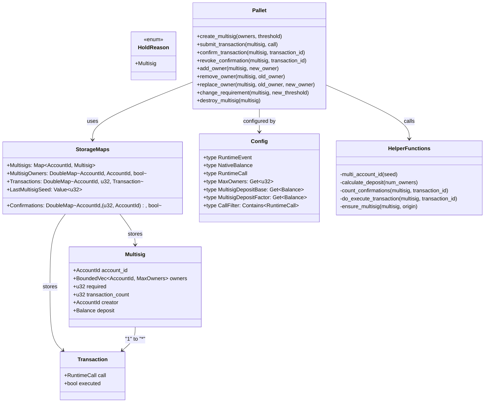

## Multisig Sequence Diagram

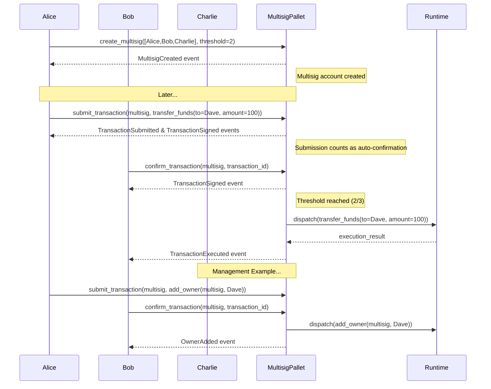
## Flow Diagrams for each extrinsic

## Create Multisig Flow

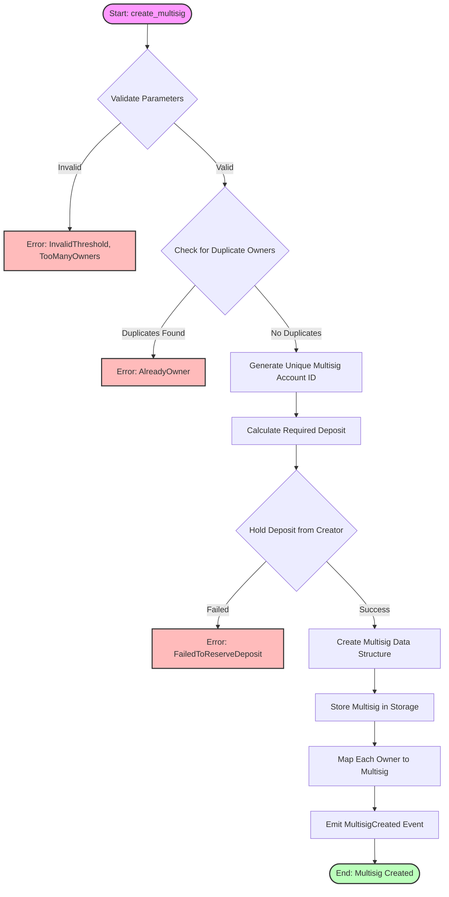

## Submit Transaction Flow

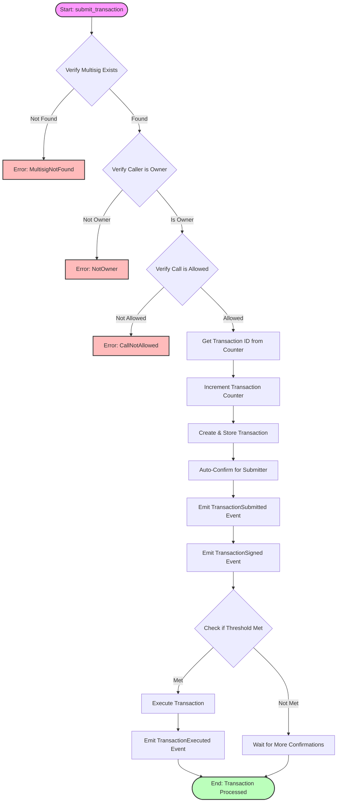

## Confirm Transaction Flow

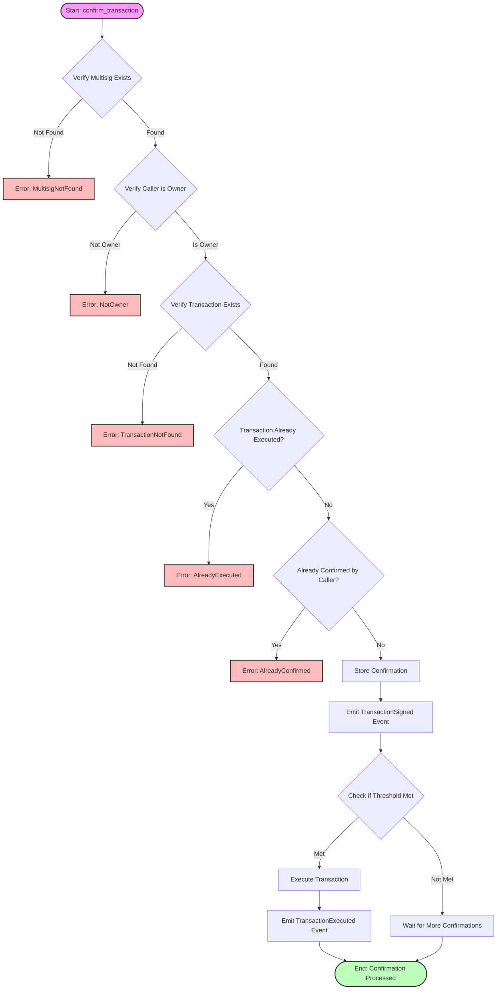

## Revoke Confirmation Flow

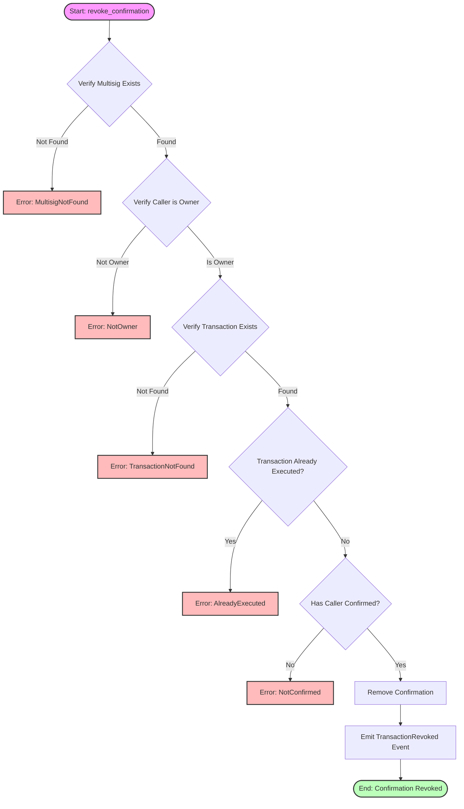

## Add Owner Flow

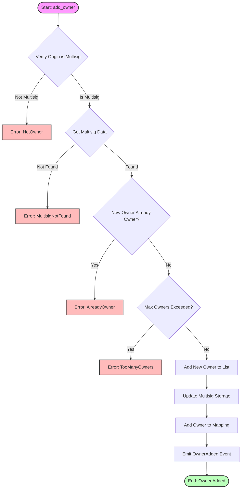

## Remove Owner Flow

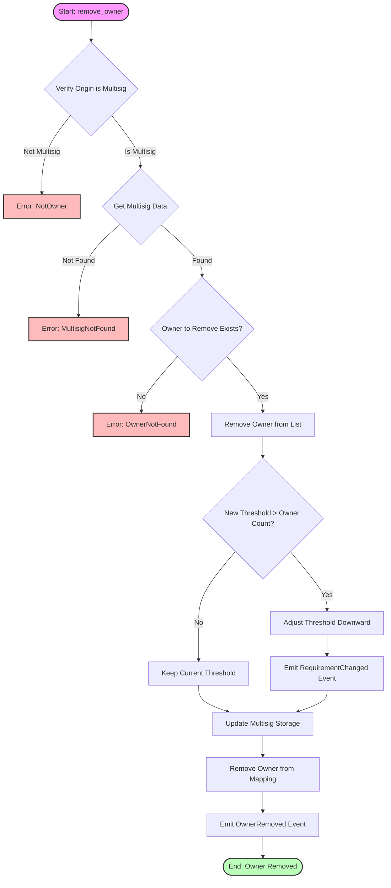

## Replace Owner Flow

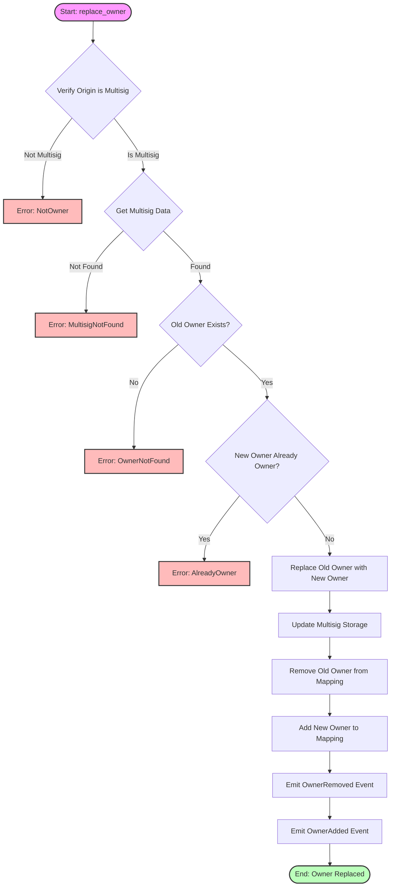

## Destroy Multisig Flow

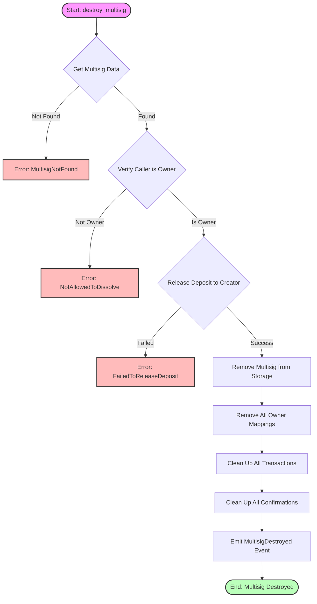

## Change Requirement Flow

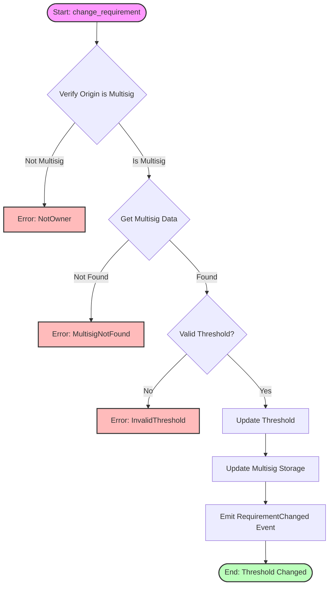
